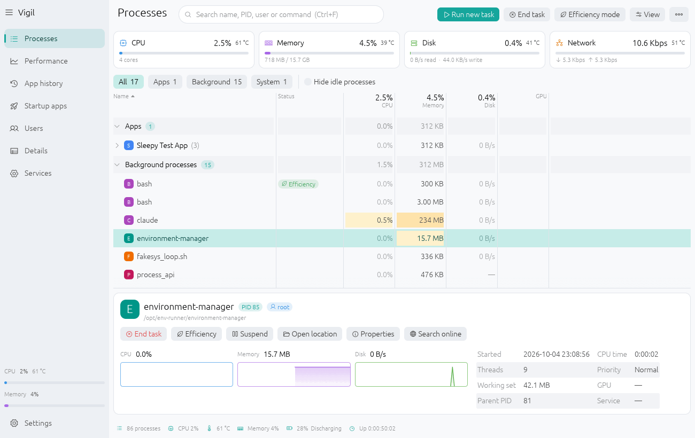
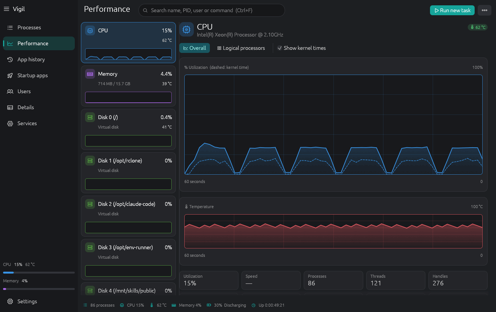

<div align="center">


# Vigil Task Manager

Task manager for Linux and Windows, modeled on the Windows Task Manager.

[](https://github.com/baba537/Vigil-Task-Manager/actions/workflows/ci.yml)
[](LICENSE)




</div>

## Features

| Page | Content |
|------|---------|
| Processes | Apps, background and system processes, apps expandable to their child processes, heat-map columns, search, optional detail strip with live graphs |
| Performance | CPU (overall / per logical processor, kernel time), memory, disks (active time, throughput, response time), network adapters, GPUs, batteries, sensors |
| App history | CPU time, disk I/O and GPU time per application, kept across restarts |
| Startup apps | XDG autostart and systemd user services on Linux; registry *Run* keys and Startup folders on Windows |
| Users | Resource usage per account |
| Details | All processes with technical columns, optional tree view |
| Services | systemd (system and user) or OpenRC on Linux, Service Control Manager on Windows |

Process actions: end task, end process tree, kill, suspend/resume, efficiency mode, priority, affinity,
open file location, properties, copy, run new task. Actions on processes of other users can be retried
as administrator (polkit on Linux, UAC on Windows).

Vigil does not open network connections. Settings and app history are stored locally.

### GPU support

| Driver | Utilization | Memory | Per process |
|---|---|---|---|
| AMD `amdgpu` | ✔ | ✔ | ✔ (DRM fdinfo) |
| Intel `i915`, `xe` | ✔ | — | ✔ (DRM fdinfo) |
| NVIDIA proprietary (NVML, loaded at runtime) | ✔ | ✔ | ✔ |
| Other DRM drivers | if exposed via fdinfo | — | if exposed |

On Linux, temperatures and other sensors come from `hwmon` and the thermal interfaces
(SATA drives need the `drivetemp` module).

## Installation

Downloads are on the [Releases page](https://github.com/baba537/Vigil-Task-Manager/releases).

| System | Package |
|---|---|
| Debian, Ubuntu and derivatives | `sudo apt install ./vigil-task-manager_*.deb` |
| Fedora, RHEL, openSUSE | `sudo dnf install ./vigil-task-manager-*.rpm` |
| Arch | [`packaging/arch/PKGBUILD`](packaging/arch/PKGBUILD) (`makepkg -si`) |
| Any Linux distribution | `vigil-<version>-linux-x86_64.tar.gz`, then `./install.sh` (user) or `sudo ./install.sh --system` |
| Windows 10 / 11 | `VigilSetup-<version>.exe` (installs per user, no administrator rights; updates in place) or the portable `vigil-<version>-windows-x86_64.zip` |

Linux binaries are built for x86_64 and aarch64 against glibc 2.28. Requirements: OpenGL 2.0 or OpenGL ES 2.0,
`libxkbcommon`, X11 or Wayland. Optional: `polkit` for administrator actions, `hwdata` for GPU names.

### Build from source

Rust 1.95 or newer:

```sh
cargo build --release
```

`--no-default-features` builds without NVIDIA support.

## Usage

```
vigil                      start the GUI
vigil --page performance   open a page: processes, performance, history, startup, users, details, services, settings
vigil --snapshot           print a system summary and exit
```

| Shortcut | Action |
|---|---|
| `Ctrl+F` / `Esc` | Search / clear search |
| `Delete` / `Shift+Delete` | End task / kill |
| `Ctrl+N` | Run new task |
| `F5` | Refresh now |
| `Ctrl+1` … `Ctrl+7` | Switch page |
| `Ctrl+,` | Settings |
| `Ctrl` `+` / `Ctrl` `−` | Zoom |

## Platform notes

- Linux: apps are detected through systemd cgroups (`app-*.scope`) and `.desktop` files.
  Per-process network usage is not shown because it would need root-level packet capture.
- Windows: process data comes from `NtQuerySystemInformation`, disk metrics from the disk performance
  counters, network data from the IP Helper API. Temperatures are only available where the firmware
  exposes ACPI thermal zones.
- Flatpak and Snap are not offered: sandboxed packages cannot see host processes.
- Rendering problems with old GPU drivers: `LIBGL_ALWAYS_SOFTWARE=1 vigil`.

Bug reports should include the output of `vigil --snapshot`. See [CONTRIBUTING.md](CONTRIBUTING.md).

## License

[GPL-3.0-or-later](LICENSE)

Parts of this project were created with AI assistance.
